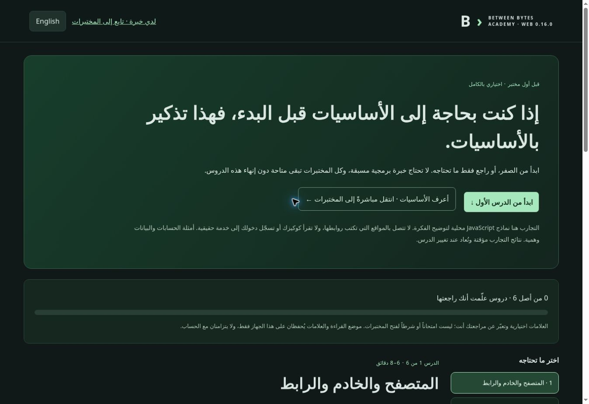

# Web 0.16.0 — optional foundations for first-time students

Add an optional invitation on the home page: “إذا كنت بحاجة إلى الأساسيات قبل البدء، فهذا تذكير بالأساسيات.” Students choose either the new refresher or a direct jump to the lab catalog. The `#labs` route focuses and scrolls to the catalog heading instead of sending experienced visitors back to the top. No lesson, review mark, account or score is required to open a lab.

## Lessons

The new bilingual `foundations.html` page starts without assuming programming experience. Each lesson defines its terms, explains an ordinary workflow, offers an editable experiment, asks an open understanding question with an optional explanation, and links to the next lesson and relevant practice.

| Lesson | Explanation | Editable experiment |
| --- | --- | --- |
| Browser, server and URL | Client-side display versus service decisions; URL components; fragments and HTTPS limits | Parse a URL using the actual URL parser without visiting it |
| HTTP | Method, path, headers, body and status meanings; why status alone is insufficient | Create/read bounded in-memory notes and inspect calculated HTTP/1.1 representations, including error outcomes |
| JSON | Objects, strings, numbers, booleans, arrays and null; syntax versus application contracts | Parse JSON, inspect actual types, and validate a quantity/note contract without coercing text into numbers |
| Sessions and permissions | Authentication versus authorization; fixed session identity versus client claims | Compare document access under session-based and vulnerable client-identity policies |
| Origins and cookies | Scheme/host/effective port; origin versus site; HttpOnly, Secure and the limits of CORS | Compare actual URL origins and illustrate two cookie flags without claiming cookie delivery or cross-origin browser enforcement |
| Lab workflow | Control request, interception, identical-input comparison, legitimate fixed control and evidence | Pause before processing a generated quote, edit it, and compare independently held vulnerable/fixed model states |

The teaching models run in JavaScript in this page. They do not fetch user-entered URLs, inspect real cookies, sign into accounts or dispatch operations to the cloud service. The page states these boundaries explicitly. Its models are separate from the academy’s Python lab engine; the last lesson links to the existing Python-powered introduction.

Cookie explanations distinguish origin from site, script access from transmission, and response readability from permission to perform an operation. The two-flag exercise does not calculate Domain, Path, SameSite, credentials mode, localhost exceptions or other browser policies. GET is presented as retrieval rather than a place for requested business mutations. Valid JSON is not presented as proof of authorization or valid application input.

## Navigation and persistence

- All six lessons are accessible from the beginning. Start-first, previous/next, direct lesson links and skip-to-labs controls are available without marking anything complete.
- Optional review marks represent the student’s own assessment. Their known lesson IDs and the last reading position are saved under `bb-foundations-v1`, separately from lab/account progress. They are not grades and do not synchronize to accounts.
- Storage failure shows a visible message and does not disable reading or experiments. Experiment outcomes are temporary and reset when changing lessons; same-page input drafts are retained for convenience. No credentials or submitted exercise inputs are placed in persistent review state.
- Rendering uses text nodes and textContent for content and editable results. Inline JSON examples are isolated left-to-right inside Arabic prose. Changed input invalidates the displayed calculation until the student explicitly runs it again.
- Foundation HTML, styles, controller, content and model modules are included in offline precaching. Existing progress keys, full explanations, 15 labs/108 cases, independent capstones and the server checkout are preserved. Existing old stylesheet references remain available to unchanged pages.

## Verification

Model and rendered-page tests cover URL boundaries and fragments, JSON syntax/type separation, fixed-session authorization, origin/default-port comparisons, bounded HTTP note creation/readback, interception before mutation, repaired quote rejection, explicit self-review, blocked storage and escaped HTML-like input. A rendered academy regression verifies that the optional invitation jumps directly to all 15 labs without completing a lesson. Offline tests verify the page and its versioned module imports.

The existing full engine/UI suite and service, navigation and Python checks remain enabled. Local validation passed 123 distinct JavaScript tests and 19 Python tests; final focused checks were rerun after presentation and HTTP-representation refinements. Generated shared content remains unchanged and `git diff --check` is clean.

Live Chrome exercised URL parsing, JSON type feedback, both identity policies, note creation followed by retrieval, matching origins, interception, weak/fixed quote outcomes and the direct skip to the actual catalog. A 390 CSS-pixel iframe verified the layout without horizontal document overflow. This is responsive browser QA, not a physical Android hardware/touch test. No deployment of this PR is claimed before merge and the existing Pages workflow succeeds.

