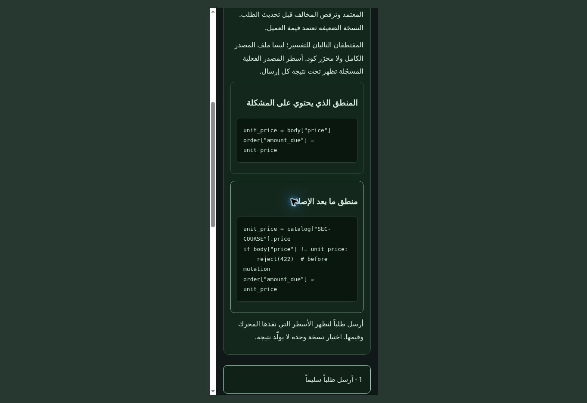

# Web 0.15.0 — visible repair logic and independent capstones

The getting-started exercise demonstrated a rejected request after repair, but did not show the repaired decision logic. Add always-visible vulnerable and repaired explanatory snippets, with the missing check explained. Actual interpreter-recorded lines are available for each observed submission; they remain clearly separate from the teaching snippets. Only the two latest submissions are shown in this explanation to keep the exercise usable on a phone.

The introduction now reads the resource before the request as well as after it. Its final step requires rejection of the identical attack input, the original amount due, and preservation of the entire resource snapshot (including revision and transactions). Editing input marks the previous result as belonging to the preceding submission. Restart locks the exercise controls while resetting and clears the observed explanation records.

Full lab pages also have a visible “Open vulnerable and repaired logic” button leading directly to the existing code-and-trace workspace. Their complete explanations and interactive browser remain available.

## Three independent capstones

The original 15 labs and 108 cases retain their catalog and behavior. The separate `challenges.html` page adds three new self-study scenarios, with different fixture values and generic decision rules rather than matching an expected attack string:

| Scenario | Investigation | Repair |
| --- | --- | --- |
| Checkout authority | Client-supplied price and owner across two products and valid quantities | Use fixed session ownership and authoritative catalog prices; reject conflicts before mutation |
| Profile policy | Ordinary display-name/time-zone edits alongside protected role and tenant | Keep role and tenant bound to the session; reject conflicting updates atomically |
| Document boundary | Raw-path checks, normalized destinations and a client-supplied identity | Authorize the resolved virtual resource against the fixed session tenant |

Each scenario has an interactive application: browse products and update a quote; edit a profile; or open virtual documents. Navigation alone does not submit operations. Optional interception pauses the application operation before dispatch, transfers its actual generated body into the editable JSON request, and requires explicit submission. Results display the actual returned order/profile/document data. A denied document never displays the private content from a preceding result.

The page offers legitimate control inputs and resource context, without a ready-made attack preset. Students may explicitly open the explanation and repair logic. This is practice, not a hidden-answer examination.

The Python engine maintains independent case/variant states and a bounded evidence ledger. Completing a round requires observed vulnerable impact, protection for an identical canonical JSON body, and a legitimate fixed control. Reordering JSON keys does not invalidate a match; using a different attack body does not satisfy matching-input protection. Invalid fields cannot award evidence or mutate the fixed resource.

The UI independently reads state before and after submission. A failed read does not confirm new completion. Students can export their recent observations and written report. Report text survives switching challenges within the page session. The capstones do not synchronize account progress or issue grades/certificates; reloading the page starts a new Worker session. Their virtual files never access host files or external networks.

## Validation

- Existing automated coverage still spans all 108 fixed controls and all 96 non-XSS attack/fixed pairs, plus existing application navigation, XSS controller behavior, code workspaces, account/service behavior and offline references.
- Capstone tests exercise alternate learner-created attacks, different legitimate products and quantities, protected-state preservation, exact recorded source lines, case/variant isolation, mismatched-input evidence, malformed field types, method/content-type failures, missing documents, failed readback, reset and explicit application interception.
- Introductory exercise tests now require visible repair logic and actual `commerce.py` traces. The full-lab regression clicks the new logic shortcut and verifies the existing repaired-code workspace opens.
- The offline asset check includes the introduction, capstones, decision renderer, new engine module and changed versioned entry points. CI syntax checks include the new scripts.
- Live Chrome verified all three introduction steps, an actual checkout control/intercept/attack/fixed flow, matching evidence completion, and denied document rendering. A 390 CSS-pixel iframe verified the new logic layout without horizontal document overflow. This is responsive browser QA, not physical Android touch/hardware testing.

Local checks use `npm run test:wasm`, `npm run test:services`, `npm run test:navigation`, Python unittest discovery, content generation and `git diff --check`. No existing checks are removed or skipped. The deployed service API and optional external-server checkout are unchanged. The new capstones run locally in Python; this change does not add email recovery or publish additional external-server labs.
